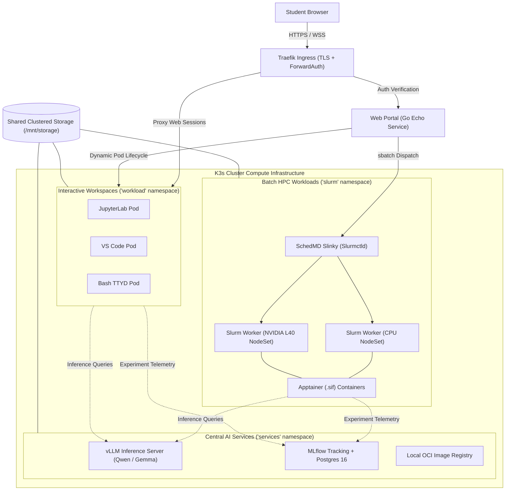

# AI Sandbox — Turnkey Educational AI Engineering Platform

The **AI Sandbox** provides students with a turnkey, browser-accessible platform for hands-on AI engineering. It offers pre-installed developer tools, managed GPU/CPU compute, curated local LLMs, and centralized experiment tracking—eliminating the need for students to navigate low-level cluster infrastructure, SSH tunnels, or custom CUDA environments.

Rather than managing isolated VMs or local containers, learners access interactive IDEs and batch HPC compute via a unified web portal backed by a multi-node Kubernetes cluster.

---

## Architecture Overview

The platform uses a **Two-Path Workload Dispatcher** architecture ([ADR 0001](file:///home/khemi/workspace/ai_sandbox/docs/aidlc/decisions/0001-two-path-workload-execution.md)) that separates interactive web-based sessions from scheduled batch HPC compute jobs while sharing storage and central services:



---

## Core Architectural Pillars

### 1. Two-Path Workload Model ([ADR 0001](file:///home/khemi/workspace/ai_sandbox/docs/aidlc/decisions/0001-two-path-workload-execution.md))
Workloads are split by operational characteristics:
* **Interactive Path:** Long-running web environments (JupyterLab, VS Code, Bash TTYD) execute as native Kubernetes OCI Pods in the `workload` namespace. The portal dynamically handles Pod/Service creation and Traefik Ingress routing with token-based ForwardAuth.
* **Batch Path:** Non-interactive, queued, multi-node compute jobs run through SchedMD Slinky (Slurm-on-Kubernetes) in the `slurm` namespace. Batch jobs run rootless Apptainer (`.sif`) containers directly off shared storage, retaining Slurm's multi-factor priority and fairshare scheduling.

### 2. Centralized AI Services ([ADR 0004](file:///home/khemi/workspace/ai_sandbox/docs/aidlc/decisions/0004-central-services-architecture.md))
To eliminate redundant resource usage and heavyweight local downloads, shared foundational services run in the `services` namespace:
* **vLLM Inference Server:** High-throughput OpenAI-compatible API serving curated models (e.g., Qwen 2.5/3.5, Gemma) with time-sliced GPU sharing.
* **MLflow Tracking Server:** Central experiment and metric logging backed by PostgreSQL 16.
* **Internal OCI Registry:** Cluster-local container distribution for fast image pulling.

### 3. Kubernetes-Native Storage & Identity Isolation ([ADR 0002](file:///home/khemi/workspace/ai_sandbox/docs/aidlc/decisions/0002-storage-and-uid-isolation.md))
The architecture eliminates complex, error-prone LDAP/SSSD configurations:
* Storage is mapped to `/mnt/storage` and scoped per workspace via Kubernetes `subPath` mounts (`projects/<project>`, `scratch`, read-only `datasets`, `models`, and `common/etc`).
* User isolation is enforced via unprivileged `PodSecurityContext` (UID `1001`, GID `2001`, `mode 2770`, `umask 0002`) and `libnss-extrausers`, preventing cross-student file pollution.

### 4. GPU Hardware Governance & QoS ([ADR 0003](file:///home/khemi/workspace/ai_sandbox/docs/aidlc/decisions/0003-single-l40-gpu-sharing-and-qos.md))
* A dedicated NVIDIA L40 (46GB) GPU on `ai-worker1` is partitioned using NVIDIA K8s Device Plugin time-slicing (`replicas: 4`).
* vLLM utilizes up to `0.65` VRAM (~28GB) for interactive chat and notebook queries.
* Exclusive batch GPU Slurm training runs coordinate with central services to yield GPU resources when needed.

---

## Repository Structure

```
.
├── portal/            # Go 1.26 Echo web portal, authentication engine, and session dispatcher
├── k8s/               # Kubernetes manifests (vLLM, MLflow, Traefik, Slinky, NetworkPolicies)
├── helm/              # Helm chart configurations and Slinky release values
├── scripts/           # Cluster verification probes, smoke tests, and build utilities
├── docs/              # Comprehensive platform documentation
│   ├── aidlc/         # AI-DLC lifecycle, working agreement, units, and ADRs
│   │   ├── decisions/ # Architectural Decision Records (0001 - 0005)
│   │   └── units/     # Active and completed work unit specifications
│   └── reports/       # Technical milestone assessment and deployment reports
├── images/            # Container definition files (OCI and Apptainer)
└── storage/           # Mock / target directory layout for shared cluster storage
```

---

## Target Infrastructure & Verification

The platform is designed to run against a multi-node **K3s** cluster hosted on **Proxmox / Bare-Metal** with attached physical compute and storage hardware. 

### Testing & Verification Pipeline

Testing follows a strict **Dual-Path Strategy** ([ADR 0005](file:///home/khemi/workspace/ai_sandbox/docs/aidlc/decisions/0005-dual-path-ci-and-runner-architecture.md)):

1. **Stage 1: Fast Static & Unit Verification (Local & Cloud CI)**
   * **Portal Unit Tests:**
     ```bash
     cd portal && go test -v -race ./...
     ```
   * **Manifest & Script Validation:**
     ```bash
     python3 scripts/lint-mermaid.py
     bash -n scripts/*.sh
     bash scripts/lint-k8s.sh
     ```

2. **Stage 2: Live In-Cluster Hardware Verification**
   Automated integration probes run directly against the live cluster to validate real hardware, GPU time-slicing, and isolation boundaries:
   * **Student Golden Path Smoke Test:** `bash scripts/test-student-golden-path.sh`
   * **LLM Inference Server Probe:** `bash scripts/verify-llm.sh`
   * **MLflow Tracking Server Probe:** `bash scripts/verify-mlflow.sh`
   * **Network & Storage Isolation Probe:** `bash scripts/verify-security.sh`

---

## Documentation & Roadmap

* [PROJECT_CONTEXT.md](file:///home/khemi/workspace/ai_sandbox/docs/aidlc/PROJECT_CONTEXT.md) — Live platform status, constraints, conventions, and problem areas.
* [UNITS.md](file:///home/khemi/workspace/ai_sandbox/docs/aidlc/UNITS.md) — Work package roadmap, active units, and completion status.
* [WORKING_AGREEMENT.md](file:///home/khemi/workspace/ai_sandbox/docs/aidlc/WORKING_AGREEMENT.md) — AI-DLC developer agreements and execution lifecycle.
* [Architectural Decision Records (ADRs)](file:///home/khemi/workspace/ai_sandbox/docs/aidlc/decisions/) — Accepted architectural choices and trade-offs.
