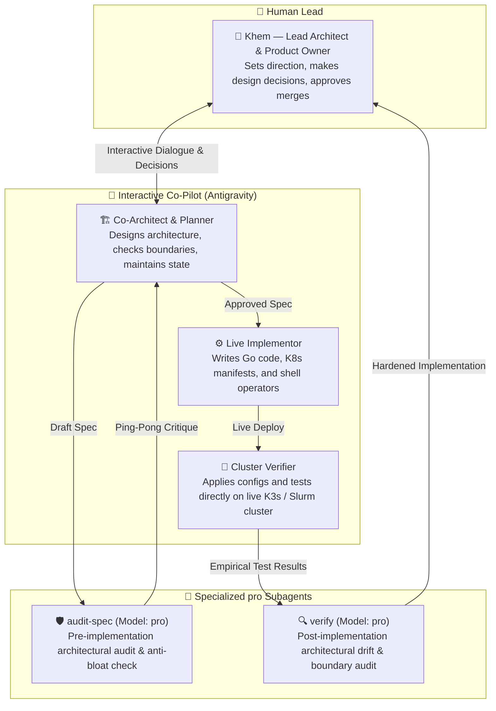

# AI Sandbox Development Workflow Guide

**Status:** ACTIVE  
**Updated:** 2026-10-25  
**Core Model:** Interactive Pair Engineering (Human Lead + AI Co-Architect & Implementor)

> **Architectural Shift Notice (Retirement of Asynchronous Jules):**  
> We no longer hand off tasks to an external asynchronous developer agent (Jules). Because the AI Sandbox operates on low-level systems (Proxmox hypervisors, K3s networking, Flannel CNI, Slurm GRES schedulers, and physical NVIDIA L40 hardware), code cannot be developed in an isolated cloud VM without live cluster access. Speculative YAML/code generation without empirical verification produced high failure rates. All design, implementation, and cluster verification are now executed interactively by **Antigravity** in direct partnership with **Khem**.

---

## 1. Roles & Collaboration Model



### 🧑 Khem — Lead Architect & Product Owner
*   **Responsibilities:** Sets strategic priorities, decides on technical trade-offs, evaluates plain-English mental models, and retains final authority on architecture and merges.
*   **Focus:** Strategic systems decisions and curriculum goals without getting bogged down in boilerplate code.

### 🌌 Antigravity — Senior Co-Architect & Live Implementor
*   **Interactive Sessions:** Operates directly inside the cluster environment with full workspace access.
*   **Responsibilities:**
    1. **Architectural Design:** Structures data flows, defines component boundaries, and challenges unverified assumptions.
    2. **Direct Implementation:** Writes the production Go portal code, Kubernetes manifests, NetworkPolicies, and automation CLIs.
    3. **Live Cluster Verification:** Directly applies manifests to the live K3s cluster, triggers test scripts (e.g. `scripts/verify-llm.sh`, `scripts/verify-mlflow.sh`), and inspects pod logs in real time to guarantee functionality.
    4. **State Maintenance:** Updates [`docs/INCREMENT_LOG.md`](file:///home/khemi/workspace/ai_sandbox/docs/INCREMENT_LOG.md) and [`docs/WORK_PACKAGES.md`](file:///home/khemi/workspace/ai_sandbox/docs/WORK_PACKAGES.md).

### 🤖 Independent `pro` Model Subagents
*   **`audit-spec` (Pre-Implementation):** Spawns an independent `pro` auditor to attack draft designs for boundary violations, over-engineering, and conceptual misalignment before writing code.
*   **`verify` (Post-Implementation):** Spawns an independent `pro` auditor to inspect the git diff and live test logs for silent architectural drift, boundary leaks, or unapproved runtime dependencies.

---

## 2. The Interactive Engineering Lifecycle

Every work package follows a structured, continuous 5-phase loop:

```
┌────────────────────────────────────────────────────────────────────────┐
│                   CONTINUOUS ENGINEERING LIFECYCLE                     │
│                                                                        │
│  ① ORIENT ──▶ ② DESIGN & AUDIT ──▶ ③ APPROVE ──▶ ④ IMPLEMENT & TEST   │
│   (State)       (audit-spec pro)     (Khem)          (Live Cluster)    │
│      ▲                                                      │          │
│      │                  ⑤ VERIFY & CLOSE ◀──────────────────┘          │
│      │                     (verify pro)                                │
│      └──────────────────────────┘                                      │
│                               next package                             │
└────────────────────────────────────────────────────────────────────────┘
```

### ① ORIENT — "Where are we? What is the goal?"
*   Antigravity reviews [`docs/WORK_PACKAGES.md`](file:///home/khemi/workspace/ai_sandbox/docs/WORK_PACKAGES.md) and [`docs/INCREMENT_LOG.md`](file:///home/khemi/workspace/ai_sandbox/docs/INCREMENT_LOG.md).
*   Khem and Antigravity agree on the immediate work package and target deliverable.

### ② DESIGN & AUDIT — "How do we build the right foundation?"
*   Antigravity sketches the draft architecture and component boundaries.
*   Antigravity invokes the [`audit-spec`](file:///home/khemi/workspace/ai_sandbox/.agents/skills/audit-spec/SKILL.md) skill (`Model: pro`):
    - Attacks the draft for 3-tier boundary leaks, unnecessary daemons, or tech-stack drift.
    - Ping-pongs with Antigravity to simplify the design.
*   Outputs a concise Plain-English Mental Model and Component Responsibility Matrix.

### ③ APPROVE — "Is the mental model clear?"
*   Khem reviews the plain-English data path and approves the design decisions.

### ④ IMPLEMENT & LIVE TEST — "Build and prove it on the cluster"
*   Antigravity creates/modifies the code, manifests, and scripts.
*   Antigravity immediately applies changes to the local development environment or production K3s cluster.
*   Runs live cluster verification probes to prove real hardware behavior.

### ⑤ VERIFY & CLOSE — "Does it pass QA and architectural audit?"
*   Antigravity executes the [`verify`](file:///home/khemi/workspace/ai_sandbox/.agents/skills/verify/SKILL.md) skill:
    - Functional QA (`go build`, lint, test scripts).
    - Architectural Result Audit (`Model: pro`) checking the diff for clean boundaries and zero bloat.
*   Antigravity logs the completion in [`docs/INCREMENT_LOG.md`](file:///home/khemi/workspace/ai_sandbox/docs/INCREMENT_LOG.md) and updates package status.

---

## 3. Git & Branching Strategy

*   **`main` (Production Branch):** Production-ready, verified state. Only Khem merges to `main`.
*   **`development` (Integration Branch):** Active staging branch.
*   **Feature Branches (`feature/*` or `feat/*`):** Created for discrete work packages. All tests must pass before merging into `development`.
*   **No Unverified Commits:** Code is committed only after automated or empirical verification succeeds.

---

## 4. Documentation & Traceability

1. **Mandatory Increment Logging:** After any package or fix is verified, record the "why", "how it works", and "empirical verification evidence" in [`docs/INCREMENT_LOG.md`](file:///home/khemi/workspace/ai_sandbox/docs/INCREMENT_LOG.md).
2. **File Linking:** Always provide clickable `file://` markdown links for modified files, configs, and documentation.
