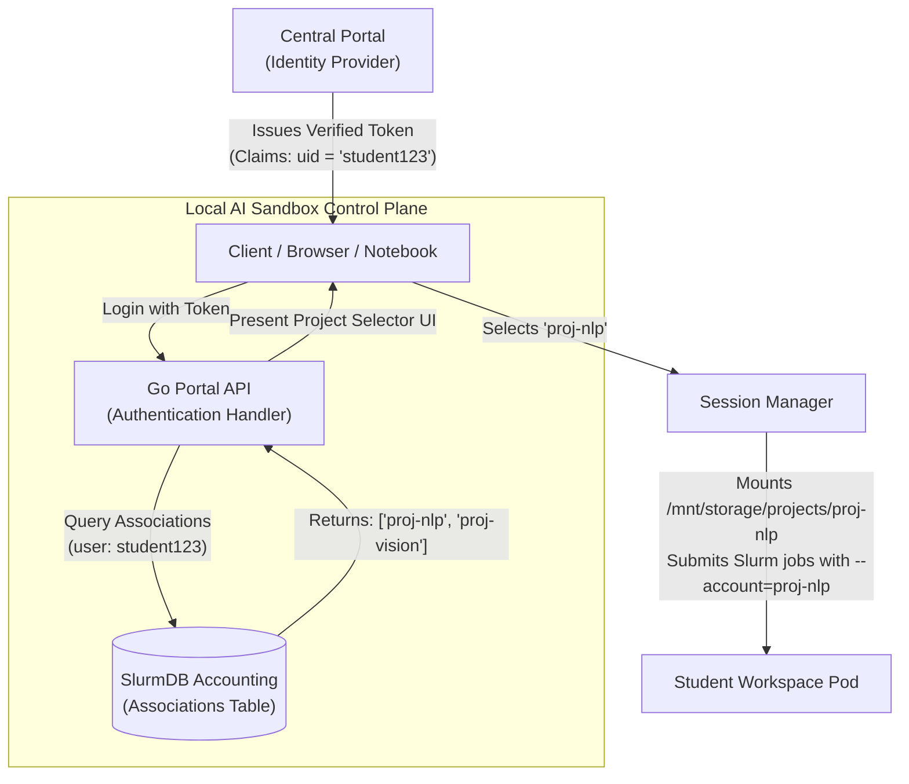
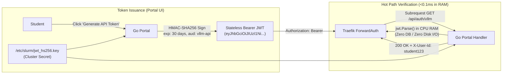
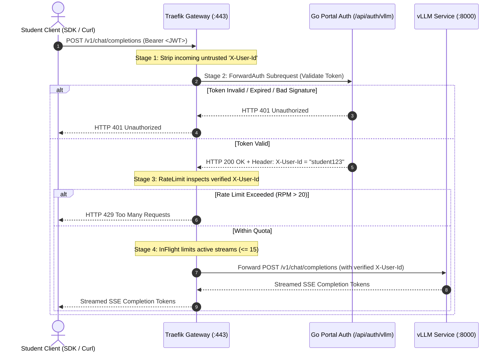

# Architecture Note: Central LLM Inference Authentication & Quality of Service (QoS)

**Document ID:** ARCH-DECISION-M3-VLLM-QOS  
**Date:** 2026-10-25  
**Authors:** Khem & Antigravity (Senior Systems Architect & Co-Architect)  
**Status:** AUDITED & ACCEPTED FOR PHASE 3 IMPLEMENTATION  
**Related Documents:**
- [`docs/MILESTONE_3_CLOSEOUT_REPORT.md`](file:///home/khemi/workspace/ai_sandbox/docs/MILESTONE_3_CLOSEOUT_REPORT.md)
- [`docs/TECH_STACK_DECISION.md`](file:///home/khemi/workspace/ai_sandbox/docs/TECH_STACK_DECISION.md)
- [`docs/CAPACITY_PLANNING.md`](file:///home/khemi/workspace/ai_sandbox/docs/CAPACITY_PLANNING.md)
- [`docs/MODEL_CATALOG.md`](file:///home/khemi/workspace/ai_sandbox/docs/MODEL_CATALOG.md)
- [`k8s/vllm-deployment.yaml`](file:///home/khemi/workspace/ai_sandbox/k8s/vllm-deployment.yaml)
- [`k8s/traefik-security-configmap.yaml`](file:///home/khemi/workspace/ai_sandbox/k8s/traefik-security-configmap.yaml)

---

## 1. Executive Summary & Problem Context

In Milestone 3, the AI Sandbox successfully deployed an always-on, high-throughput LLM inference server powered by vLLM (`vllm/vllm-openai:v0.31.0`) on `ai-sandbox-gpu-vm`. However, two architectural gaps were accepted as technical debt for Phase 3:
1. **Unauthenticated Access & Coarse Rate Limiting:** The Traefik gateway routed `/v1` without validating Bearer tokens or verifying user identity. Rate limiting was IP-bucketed, throttling multi-tenant student pods sharing node IPs.
2. **Suboptimal GPU Memory Utilization:** The vLLM service was capped at `--gpu-memory-utilization 0.65` (~28 GiB VRAM) to allow Kubernetes time-slicing alongside Slurm batch jobs on the single NVIDIA L40 (48GB) accelerator.

Following the pre-implementation architectural audit, this document establishes the hardened specification:
- **100% Stateless Authentication:** Pure HMAC-SHA256 signed Bearer tokens verified in CPU memory (<0.1ms) without database lookups or disk I/O, maintaining the stateless portal guarantee.
- **Strictly Ordered Traefik Pipeline:** Header sanitization, ForwardAuth verification, user-keyed rate limiting (20 RPM per `uid`), and in-flight concurrency gating (15 streams).
- **Dedicated L40 GPU for PoC QoS Profiling:** Slurm `batch-gpu` is placed on standby; Kubernetes time-slicing is removed; vLLM claims `--gpu-memory-utilization 0.90` with 10% headroom reserved for CUDA/PyTorch dynamic activation scratchpads.
- **Strict Separation of Accounting:** Slurm batch jobs account by Project (`--account=<proj>`), while central inference meters strictly by User (`uid`) for anti-starvation. SlurmDB is kept completely off the inference data path.

---

## 2. Authentication, Authorization & Quota Architecture

### 2.1 Identity vs. Workspace Decoupling

The platform strictly decouples global authentication (who you are) from local resource accounting (what project you are working on):



#### Architectural Rules:
1. **Central Portal is strictly the Identity Provider (IdP):** Central Portal validates credentials and asserts identity (`uid` / `sub`). It contains zero domain knowledge of Sandbox projects, Slurm partitions, or local storage.
2. **SlurmDB resolves Batch/Interactive Workspace Context ONLY:** The Go Portal queries local `slurmdbd` associations when launching Jupyter notebooks or batch jobs.
3. **Inference Path is Decoupled from SlurmDB:** Because inference rate limiting is keyed strictly to the user (`uid`), `/api/auth/vllm` **never queries SlurmDB or MariaDB**. It performs 100% in-memory token verification, shielding cluster database tables from high-frequency API traffic.

---

### 2.2 Per-User Inference Quotas (Anti-Starvation)

Inference rate limiting is keyed strictly to the **User ID (`uid`)**, never to the Project.

| Dimension | Slurm Batch / Interactive Compute | Central vLLM Inference API |
| :--- | :--- | :--- |
| **Accounting Unit** | **Project / Account** (`--account=<proj>`) | **Individual User** (`X-User-Id: <uid>`) |
| **Resource Tracked** | GPU-hours, CPU-hours, RAM allocation | Requests per minute (RPM), Concurrency |
| **Isolation Rationale** | Shared lab budgets, departmental billing, fair-share scheduling. | **Anti-starvation:** Prevents a single student with an aggressive script from exhausting the quota of an entire collaborative project group. |
| **Enforcement Layer** | Slurm Fair-Share / SlurmDB cgroups | Traefik in-memory token bucket (`rateLimit`) + vLLM `inFlightReq` |

---

### 2.3 Stateless HMAC Token Model (Replacing Stateful API Keys)

To uphold the stateless mandate of [`docs/TECH_STACK_DECISION.md`](file:///home/khemi/workspace/ai_sandbox/docs/TECH_STACK_DECISION.md) and eliminate database dependencies:



#### Why Stateless HMAC Outperforms Stateful Database Keys:
1. **Zero Database Infrastructure:** No SQLite tables, no MySQL migrations, no NFS lock contention, and no backups required for API keys.
2. **Sub-Millisecond Verification:** Verification executes in CPU RAM via `jwt.Parse` against the local secret key (`/etc/slurm/jwt_hs256.key`). Execution latency is `< 0.1ms`.
3. **Resilience across Pod Restarts:** The Portal remains completely stateless. Portal pods can restart, scale horizontally, or reschedule without losing active tokens.
4. **Token Structure:**
   - Header: `{"alg": "HS256", "typ": "JWT"}`
   - Claims: `{"sub": "student123", "aud": "vllm-api", "iss": "ai-sandbox-portal", "exp": <30_days>}`
   - Signature: `HMAC-SHA256(secret, header.payload)`

---

### 2.4 Traefik ForwardAuth & Rate Limiting Pipeline

To prevent header spoofing, unauthenticated slot exhaustion, and empty-header rate-limit collisions, Traefik enforces a strict 4-stage pipeline:



#### Traefik Middleware Configuration:
```yaml
# k8s/traefik-security-configmap.yaml
http:
  routers:
    vllm-api:
      entryPoints:
        - websecure
      rule: "PathPrefix(`/v1`)"
      service: vllm-backend
      priority: 100
      middlewares:
        - vllm-strip-user-header # Stage 1: Purge untrusted client X-User-Id
        - vllm-forwardauth       # Stage 2: In-memory HMAC auth & inject verified X-User-Id
        - vllm-ratelimit         # Stage 3: Token bucket (20 RPM per X-User-Id)
        - vllm-inflight          # Stage 4: Cap concurrent GPU streams to 15

  middlewares:
    vllm-strip-user-header:
      headers:
        customRequestHeaders:
          X-User-Id: ""

    vllm-forwardauth:
      forwardAuth:
        address: "http://127.0.0.1:8080/api/auth/vllm" # Co-located pod loopback (sub-millisecond RAM verification)
        trustForwardHeader: true
        authResponseHeaders:
          - "X-User-Id"

    vllm-ratelimit:
      rateLimit:
        average: 20
        burst: 5
        period: 1m
        sourceCriterion:
          requestHeaderName: "X-User-Id"

    vllm-inflight:
      inFlightReq:
        amount: 15
```

---

## 3. Dedicated L40 GPU Allocation Strategy

### 3.1 PoC Hardware Exclusivity Decision
- **Cluster State:** Active PoC / pre-production phase with zero live classes. Single NVIDIA L40 (48GB) accelerator installed on `ai-sandbox-gpu-vm`.
- **Decision:** Dedicate `ai-sandbox-gpu-vm` 100% to central LLM serving.
- **Trade-off:**
  - Kubernetes GPU time-slicing is removed.
  - The Slurm `batch-gpu` partition is placed on standby (batch training jobs will not schedule until secondary GPU hardware is online).
  - This allows vLLM to scale without noisy-neighbor interference and enables rigorous empirical QoS profiling.

### 3.2 VRAM Budgeting & Headroom Allocation (`--gpu-memory-utilization 0.90`)

With 46,068 MiB physical VRAM on the NVIDIA L40, allocation is capped at `0.90` to guarantee stability:

```
+-------------------------------------------------------------------------------+
|                       PHYSICAL NVIDIA L40 VRAM: 46,068 MiB                     |
+---------------------------------------------------+---------------------------+
|               vLLM PRE-ALLOCATED POOL (90%)       | DYNAMIC HEADROOM (10%)    |
|                      (~41,460 MiB)                |        (~4,608 MiB)       |
+-------------------------+-------------------------+---------------------------+
| Model Weights           | Paged KV Cache Pool     | PyTorch Runtime Buffers   |
| (Safetensors)           | (PagedAttention)        | CUDA Driver Context       |
| - Qwen 2.5 32B AWQ:     | - Qwen 2.5 32B AWQ:     | Activation Tensors        |
|   18.14 GiB             |   ~23.32 GiB            | FlashInfer Scratchpads    |
| - Qwen 3.5 0.8B:        | - Qwen 3.5 0.8B:        | Dynamic Forward Pass RAM  |
|   1.72 GiB              |   ~39.74 GiB            | (Prevents CUDA OOM)       |
+-------------------------+-------------------------+---------------------------+
```

> **Why not 1.0 (100%)?** vLLM pre-allocates model weights and its entire KV cache block pool at process launch. Setting utilization to `1.0` leaves 0 bytes for CUDA context, FlashInfer scratchpad buffers, or intermediate activation tensors during model forward passes, which triggers immediate, unrecoverable CUDA Out-Of-Memory crashes. The 10% headroom (~4.6 GiB) is the physical safety margin required by the NVIDIA driver.

---

## 4. Quality of Service (QoS) & Service Level Objectives (SLOs)

### 4.1 Formal QoS Metric Matrix

| Metric | Target SLA / SLO | Operational Definition | Enforcement Layer |
| :--- | :--- | :--- | :--- |
| **TTFT (Cold Prefill)** | **P95 < 400ms** (prompts $\le$ 2K) | Elapsed time from HTTP request receipt to delivery of the first streamed SSE token on uncached prompts. | `--enable-chunked-prefill=true`<br/>`--max-num-batched-tokens 2048` |
| **TTFT (Warm / Cached)** | **P95 < 30ms** (shared prefixes $\ge$ 512 tokens) | Latency to first token when a request matches an existing prefix in the Radix KV cache (hit rate itself is prompt-dependent and excluded from SLAs). | `--enable-prefix-caching=true` |
| **TPOT (Time Per Output Token)** | **P95 < 35ms/token** ($\ge$ 28 tok/s) | Inter-token generation latency during decoding. Prevents user-facing stuttering. | PagedAttention backend with FlashInfer kernels |
| **Max Concurrency** | **15 active streams** (gateway cap) | Simultaneous active generation streams before request queuing occurs. | Traefik `vllm-inflight` (amount: 15) |
| **User Request Rate** | **20 req / min** (burst: 5) | Per-user rate limit bucket enforcing fair-share access across students. | Traefik `vllm-ratelimit` (`sourceCriterion: X-User-Id`) |
| **Queue Latency & Rejection** | Queue wait **< 2.0s**; reject with **HTTP 429** on backlog | Requests waiting in Traefik or vLLM queue are rejected when in-flight slots are saturated. | Traefik `inFlightReq` + vLLM internal scheduling queue |

### 4.2 Critical vLLM Engine Tunings

1. **Chunked Prefill (`--enable-chunked-prefill=true`):**  
   Standard continuous batching prioritizes large prompt prefills, which stalls active decode phases and produces severe TPOT jitter for concurrent users. Chunked prefill breaks long prompt evaluation into 2048-token chunks, interleaving prefill with ongoing token decode batches.
2. **Prefix Caching & SLA Scoping (`--enable-prefix-caching=true`):**  
   In classroom settings, multiple students submit queries sharing identical system prompts or reference documents. Prefix caching prevents redundant attention re-computation, dropping TTFT for cached prefixes from ~500ms to <30ms.  
   *SLA vs. Engine Decoupling:* Cache hit percentage is **not** guaranteed as an infrastructure SLA, because hit rate is non-deterministic and dictated by student prompt entropy. The infrastructure guarantees latency conditionally (Warm TTFT < 30ms upon hit), while the vLLM engine reaps all opportunistic performance gains during multi-turn dialogs and shared lab templates.
3. **Bounded Context & Concurrency Sizing:**  
   `--max-model-len 16384` paired with `--max-num-seqs 64` prevents the engine from accepting more concurrent sequences than can fit in the physical VRAM KV cache, preventing emergency block swapping to host memory.

---

## 5. Implementation Roadmap & Staging

| Step | Work Package | Description | Target Deliverables |
| :---: | :--- | :--- | :--- |
| **1** | **vLLM VRAM Scale-up** | Raise `--gpu-memory-utilization` from `0.65` to `0.90` and add QoS flags (`chunked-prefill`, `prefix-caching`). | Update [`k8s/vllm-deployment.yaml`](file:///home/khemi/workspace/ai_sandbox/k8s/vllm-deployment.yaml). Verify deployment stability via `scripts/swap-model.sh`. |
| **2** | **Portal Stateless Auth Endpoint** | Implement fast in-memory HMAC JWT issuance and validation endpoint `/api/auth/vllm` in Go Portal without DB queries. | Update `portal/auth.go` and `portal/handlers.go`. |
| **3** | **Traefik Security Ingress Update** | Configure 4-stage pipeline (header sanitization, `ForwardAuth`, `RateLimit` with `X-User-Id`, `inFlightReq`). | Update [`k8s/traefik-security-configmap.yaml`](file:///home/khemi/workspace/ai_sandbox/k8s/traefik-security-configmap.yaml). |
| **4** | **QoS & Latency Benchmarking** | Execute automated concurrency, TTFT, and TPOT load tests under simulated multi-student traffic. | Create `scripts/benchmark-qos.py` (measuring P50/P95 TTFT and tokens/s). |
