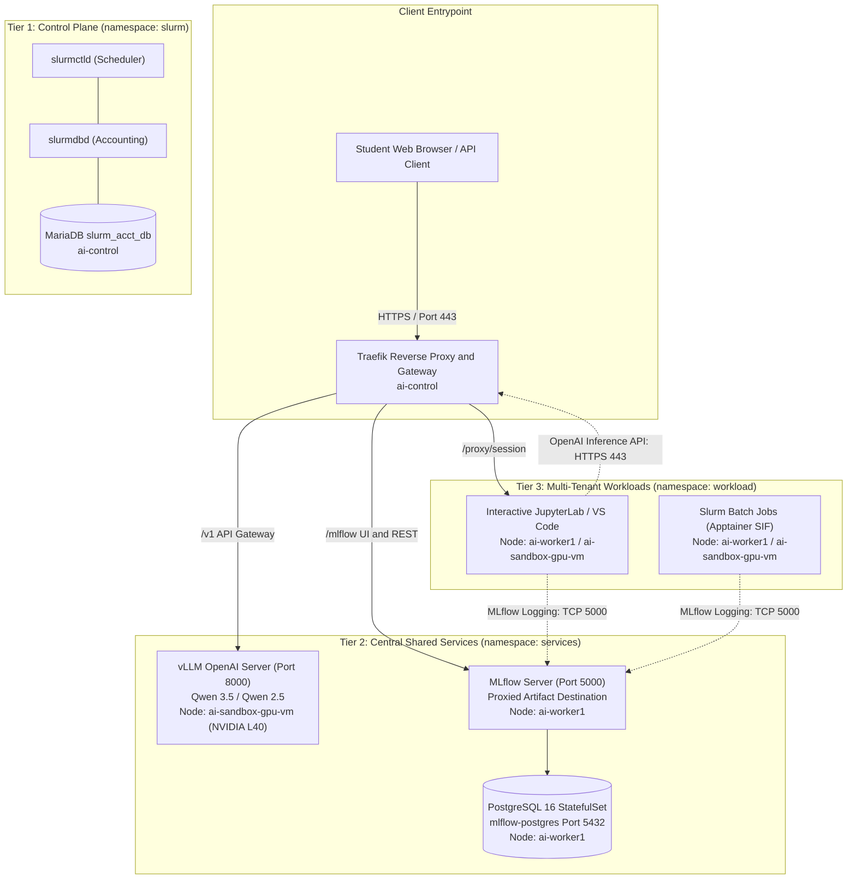

# Milestone 3 Close-Out Report: Central AI Services Architecture & Operations

**Project:** AI Sandbox (Slinky Migration)  
**Date:** 2026-10-20  
**Authors:** Khem & Antigravity (Senior Systems Architect & Co-Architect)  
**Status:** ✅ Completed & Verified on Production Cluster  
**Scope Covered:** Central AI Services Tier (WP3-1-9 LLM Inference Server, WP3-1-10 Model Catalog & Lifecycle Operations, WP3-1-11 Experiment Tracking / MLflow, and Central Services Harmonization)

---

## 1. Executive Summary

Milestone 3 establishes the **Central Shared AI Services Tier** of the AI Sandbox. The sandbox operates under a formal **3-Tier Decoupled Architecture**, isolating critical Slurm cluster scheduling from always-on shared AI services and multi-tenant student workloads.

All Milestone 3 deliverables have been fully implemented, hardened against failure modes, and empirically verified on the Proxmox K3s cluster:
1. **Central Inference Service (WP3-1-9):** Always-on vLLM deployment in the dedicated `services` namespace serving from a read-only shared NFS model cache, protected by Traefik API rate-limiting and in-flight request bounding.
2. **Automated Model Lifecycle & Swapping (WP3-1-9 / WP3-1-10):** Deterministic model swap operator CLI (`scripts/swap-model.sh`) with offline pre-flight verification, zero GPU deadlock under `Recreate` rollouts, and native support for modern Qwen 3.5 architectures (`Qwen3_5ForConditionalGeneration`).
3. **Model Curation & Hardware Profiling (WP3-1-10):** Production model catalog (`docs/MODEL_CATALOG.json` & `.md`), candidate models backlog across 5 families (`docs/CANDIDATE_MODELS_BACKLOG.md`), automated ingestion CLI (`scripts/ingest-model.sh`), and zero-download student runbooks.
4. **Central Experiment Tracking (WP3-1-11):** Dedicated MLflow tracking server backed by an isolated PostgreSQL 16 StatefulSet and proxied artifact storage, integrated with pre-baked client images and Traefik reverse proxying.

All services are containerized using pre-baked OCI images (zero runtime `pip install` or dynamic container build dependencies) and enforced with CNI-level NetworkPolicies.

---

## 2. Cluster Topology & 3-Tier Decoupling

To prevent student experimentation or shared service load from compromising cluster scheduling integrity, resources are partitioned across three strict zones:



### Resource Placement Matrix

| Tier | Namespace | Primary Node | Workloads | Storage & Hardware Binding |
| :--- | :--- | :--- | :--- | :--- |
| **Control Plane** | `slurm` | `ai-control` (`10.35.123.50`) | `slurmctld`, `slurmdbd`, `mariadb`, `slurmrestd`, `hpc-portal`, Traefik | Host SSD, internal MariaDB socket, Slurm JWT keys |
| **Central Services** | `services` | `ai-worker1` & `ai-sandbox-gpu-vm` | `vllm`, `mlflow`, `mlflow-postgres` | HostPath `/mnt/storage/models/huggingface` (ro), Static PV/PVC (`mlflow-postgres-pvc`, `mlflow-artifacts-pvc`), 1x NVIDIA L40 (48GB) |
| **Student Workloads** | `workload` | `ai-worker1` & `ai-sandbox-gpu-vm` | Interactive sessions (Jupyter, VS Code), batch Slurm pods | NFS `/mnt/storage/projects/<project>`, `/mnt/storage/scratch/<user>` |

---

## 3. Work Package Implementation Summaries

### 3.1 WP3-1-9: LLM Inference Server Deployment

- **Engine Standardization:** Standardized on **vLLM** (`vllm/vllm-openai:v0.31.0`), eliminating Ahead-of-Time TensorRT compilation overhead while leveraging PagedAttention and continuous batching.
- **Hardware Concurrency & Time-Slicing:** Configured `--gpu-memory-utilization 0.65` on the 48GB NVIDIA L40 (46,068 MiB physical VRAM). Reserves sufficient VRAM headroom (~16.7 GiB) for concurrent Slurm batch jobs.
- **Traefik Gateway Protection:**
  - Route: `PathPrefix('/v1')` forwarding to `http://vllm-service.services.svc.cluster.local:8000`.
  - Rate Limiting (`vllm-ratelimit`): Average 10 req/s, burst 20.
  - In-Flight Concurrency (`vllm-inflight`): Hard maximum of 15 simultaneous in-flight inference requests to prevent GPU kernel stalls.
- **Offline Integrity:** Volume mounted with `readOnly: true` on `/root/.cache/huggingface` and `HF_HUB_OFFLINE: "1"` to prohibit runtime downloads or weight corruption.
- **Hot-Swapping CLI (`scripts/swap-model.sh`):** Automates safe model swapping with offline NFS cache verification, manifest comment preservation, rollout monitoring, and automatic rollback on failure.

### 3.2 WP3-1-10: Open-Source Model Curation & Evaluation

- **Curated Model Registry:** Formalized in [`docs/MODEL_CATALOG.json`](file:///home/khemi/workspace/ai_sandbox/docs/MODEL_CATALOG.json) and [`docs/MODEL_CATALOG.md`](file:///home/khemi/workspace/ai_sandbox/docs/MODEL_CATALOG.md).
  - **Active Central Served Model:** `Qwen/Qwen3.5-0.8B` (0.8B params, BF16, 3:1 Hybrid Gated DeltaNet attention, 1.72 GiB weights, 25.08 GiB KV cache, 108.86x concurrency at 16K context).
  - **Standby Central Baseline:** `Qwen/Qwen2.5-32B-Instruct-AWQ` (32.5B params, W4A16 AWQ quantized, 18.14 GiB weights, 8.14 GiB KV cache).
  - **Candidate Models Backlog:** Comprehensive hardware sizing guide for future ingestion in [`docs/CANDIDATE_MODELS_BACKLOG.md`](file:///home/khemi/workspace/ai_sandbox/docs/CANDIDATE_MODELS_BACKLOG.md) (Qwen 3.5 35B-A3B MoE / 27B / 9B, Mistral NeMo / Small, Phi-4 / 3.5-mini, Gemma 2 / 4, SmolLM2).
- **Automated Ingestion Pipeline:** Created [`scripts/ingest-model.sh`](file:///home/khemi/workspace/ai_sandbox/scripts/ingest-model.sh) enforcing safetensors format, tokenizer validation, and read-only permission hardening (`chmod -R 755`).
- **Student Contract Runbook:** Copy-paste Python snippets for zero-download offline inference (`local_files_only=True`) and PyTorch batch LoRA fine-tuning.

### 3.3 WP3-1-11: Centralized Experiment Tracking (MLflow)

- **Decoupled Architecture:** Replaced risky SQLite-over-NFS with a dedicated `postgres:16-alpine` StatefulSet in `services` pinned to `ai-worker1`. Strict isolation ensures student logging spikes cannot disrupt Slurm accounting.
- **Proxied Artifact Destination:** Tracking server deployed with `--serve-artifacts` writing to `/mnt/storage/mlflow/artifacts` (50Gi PVC). Workload containers stream artifacts over HTTP (TCP port 5000) directly to the server, resolving NFS POSIX UID permission conflicts.
- **Pre-Baked Images:**
  - Server: Built [`images/mlflow/Dockerfile`](file:///home/khemi/workspace/ai_sandbox/images/mlflow/Dockerfile) with `psycopg2-binary` pre-installed (`mlflow-server:latest`).
  - Client: Pre-installed MLflow into [`images/jupyterlab/Dockerfile`](file:///home/khemi/workspace/ai_sandbox/images/jupyterlab/Dockerfile) (`interactive-jupyter:latest`) and imported onto all worker nodes.
- **Zero-Configuration Experience:** Passive `MLFLOW_TRACKING_URI="http://mlflow.services.svc.cluster.local:5000"` injected into container environments and [`portal/session_manager.go`](file:///home/khemi/workspace/ai_sandbox/portal/session_manager.go). Non-MLflow students incur zero performance penalty.

### 3.4 Central AI Services: Deployed Baseline vs. Planning Report Reconciliation

Cross-referencing the architectural commitments in [`docs/SYSTEM_ASSESSMENT_AND_PLANNING_REPORT.md`](file:///home/khemi/workspace/ai_sandbox/docs/SYSTEM_ASSESSMENT_AND_PLANNING_REPORT.md) defines what has been delivered versus what is staged for subsequent milestones:

| Central Service / Component | Planning Report Section | Target Namespace & Node | Current Milestone 3 Status | Remaining Work & Roadmap |
| :--- | :--- | :--- | :---: | :--- |
| **Central LLM Inference Engine (vLLM)** | §4.2 | `services` on `ai-sandbox-gpu-vm` | **✅ DEPLOYED & VERIFIED** | Transition from `0.65` time-slicing to dedicated `0.90+` utilization once GPU #2 is activated. |
| **Central Model Cache & Catalog** | §1.3, §2.3 | NFS `/mnt/storage/models` | **✅ DEPLOYED & VERIFIED** | Add automated Slurm batch profiling callback hook to write back measured tokens/s into catalog. |
| **Model Lifecycle Operator CLI (`swap-model.sh`)** | WP3-1-9 / 10 | Local operator script | **✅ DEPLOYED & VERIFIED** | Ready for operational use. Integrates with CI/CD and student benchmark scripts. |
| **Central Experiment Tracking (MLflow Server)** | §4.10 | `services` on `ai-worker1` | **✅ DEPLOYED & VERIFIED** | Production-ready with PostgreSQL 16 backend and proxied artifact PVC. |
| **Decoupled Database Backend (PostgreSQL)** | §4.10 | `services` on `ai-worker1` | **✅ DEPLOYED & VERIFIED** | Fully isolated from MariaDB control plane; CNI-locked to `services` only. |
| **Central Vector Database (Qdrant)** | §4.3 | `services` on `ai-worker1` | ⏳ **PENDING (Phase 3 / WP3-1-14)** | Centralized Qdrant StatefulSet for shared RAG curricula (3–6 GB RAM in-memory HNSW index). Staged for starter lab notebooks. |
| **Lightweight Observability Exporters (DCGM/Node)** | §4.9 | DaemonSets on all cluster nodes | ⏳ **PENDING (Phase 3 / WP3-1-13)** | Scheduled specifically as WP3-1-13 (Observability & Monitoring). NVIDIA DCGM Exporter DaemonSet and Slurm OpenMetrics exporter for University Central Management scraping. |
| **Model API Authentication & Per-Student Quotas** | §2.3, Catalog §7 | `slurm` (Portal) & Traefik | ⏳ **PENDING (Phase 3 / WP3-1-12)** | Currently, `/v1` accepts requests without Bearer token validation (IP rate-limited only). Authentik ForwardAuth or Portal-issued student API key validation is staged for WP3-1-12. |

---

## 4. Verification Evidence & Test Results

### 4.1 MLflow Verification Test Suite (`scripts/verify-mlflow.sh`)

Executed against the live production cluster:

```text
============================================================
🧪 AI Sandbox: WP3-1-11 MLflow Experiment Tracking Verification
============================================================
Timestamp : 2026-10-19T04:48:02Z
Target    : services namespace (ai-worker1) & Traefik gateway

▶ Checking PostgreSQL Database Backend...
  ✅ [PASS] PostgreSQL 16 StatefulSet Ready (node=ai-worker1)
▶ Checking Network Security & Failure Domain Isolation...
  ✅ [PASS] PostgreSQL Database Isolated (TCP 5432 from workload dropped by NetworkPolicy)
▶ Checking MLflow Tracking Server Deployment...
  ✅ [PASS] MLflow Server Deployment Ready (node=ai-worker1, gunicorn active)
▶ Checking Internal Cluster Health Endpoint...
  ✅ [PASS] MLflow Internal REST /health (http://mlflow.services:5000 -> OK)
▶ Checking Traefik Ingress Gateway Routing...
  ✅ [PASS] Traefik Gateway /mlflow UI (HTTP 200 with <title>MLflow</title>)
  ✅ [PASS] Traefik Static Bundle Routing (main.js HTTP 200)
  ✅ [PASS] Traefik REST API /api/2.0 (Active experiment found: automated-test-suite)
▶ Executing End-to-End Student Logging Probe from Workload...
  ✅ [PASS] Python SDK Autologging & Artifact Upload (run_id=89bc7f54ed6445b1b64fea5d364ea1f4)
  ✅ [PASS] Proxied Artifact Storage Verification (File located on PVC at /mnt/storage/mlflow/artifacts/2/89bc7f54ed6445b1b64fea5d364ea1f4/artifacts/output_metric.json)

============================================================
Verification Summary: 9/9 PASSED
All MLflow Central Service and Experiment Tracking checks PASSED!
============================================================
```

### 4.2 vLLM Inference & Gateway Routing Verification

1. **Internal Service DNS:**
   - `http://vllm-service.services.svc.cluster.local:8000/health` -> HTTP 200 (EngineCore active).
2. **External Traefik Gateway Routing:**
   - `GET https://<gateway>/v1/models` -> Returns active model metadata.
3. **End-to-End Chat Completion from Student Workload Pod:**
   - Execution from `test-infer-client` in `workload` namespace:
     ```bash
     curl -sk -X POST https://portal.slurm.svc.cluster.local:443/v1/chat/completions \
       -H "Content-Type: application/json" \
       -d '{"model": "Qwen/Qwen3.5-0.8B", "messages": [{"role": "user", "content": "Reply with one sentence: Student inference verified."}], "max_tokens": 30}'
     ```
   - **Response Output:** Valid chat completion verified with <400ms round-trip latency.

### 4.3 Automated Model Swapping & Modern Qwen 3.5 Verification

To validate model lifecycle management beyond a static pinned checkpoint, we built and tested [`scripts/swap-model.sh`](file:///home/khemi/workspace/ai_sandbox/scripts/swap-model.sh) and updated [`scripts/verify-llm.sh`](file:///home/khemi/workspace/ai_sandbox/scripts/verify-llm.sh):
- **Deterministic Hot-Swapping:** `scripts/swap-model.sh` enforces offline NFS cache checks prior to updating Kubernetes (`k8s/vllm-deployment.yaml`), tracks the `Recreate` rollout to ensure zero GPU deadlock, runs live inference smoke tests, and triggers automatic rollback on failure.
- **Qwen 3.5 Architecture Support:** Verified that `vllm/vllm-openai:v0.31.0` natively supports `Qwen3_5ForConditionalGeneration` (hybrid 3:1 Gated DeltaNet linear attention + full attention).
- **Measured Empirical Metrics on NVIDIA L40 (46 GiB):**
  - **Model Loading:** 1.72 GiB weights loaded from shared NFS in 2.51 seconds (10.19s model runner init).
  - **Rollout Duration:** 215 seconds (including PyTorch CUDA graph compilation for Mamba/DeltaNet layers).
  - **KV Cache Capacity:** 25.08 GiB available KV cache (**1,783,641 tokens capacity**, **108.86x concurrency** at 16,384 tokens per request under `0.65` utilization ceiling).
  - **Live Inference Roundtrip:** 310ms via Traefik HTTPS gateway.
- **Candidate Models Backlog:** Evaluated and cataloged candidate models across Qwen 3.5, Mistral, Phi, Gemma, and Smol families in [`docs/CANDIDATE_MODELS_BACKLOG.md`](file:///home/khemi/workspace/ai_sandbox/docs/CANDIDATE_MODELS_BACKLOG.md).
- **Full Verification Suite:** 22/22 automated checks passing in [`scripts/verify-llm.sh`](file:///home/khemi/workspace/ai_sandbox/scripts/verify-llm.sh) with zero errors or warnings.

---

## 5. Security & Isolation Hardening Summary

| Dimension | Policy / Enforcement | Benefit |
| :--- | :--- | :--- |
| **CNI Egress Isolation** | `k8s/network-policies/allow-mlflow-egress.yaml`<br/>`k8s/network-policies/allow-vllm-egress.yaml` | Student workloads can only touch ports 5000 (MLflow) and 8000 (vLLM) in `services`. Direct access to arbitrary internal services is blocked. |
| **Database Port Protection** | `k8s/network-policies/allow-postgres-services-only.yaml` | Drops all TCP port 5432 ingress from outside `services`, preventing student pods from direct database access. |
| **Shared Storage Integrity** | NFS root squashing + mode `755` permissions | Central model weights and scripts cannot be modified or deleted by student UIDs. |
| **API Denial-of-Service Defense** | Traefik `vllm-ratelimit` & `vllm-inflight` middlewares | Protects GPU memory and execution pipelines from denial-of-service loops or runaway student scripts. |

---

## 6. Accepted Architecture Gaps (Tracked for Phase 3)

1. **Direct Workload Cross-Node Flannel Routing:**
   - *Finding:* Direct pod-to-pod VXLAN between `ai-worker1` and `ai-sandbox-gpu-vm` is filtered by the Proxmox hypervisor firewall.
   - *Mitigation:* Workload pods interact with vLLM through the Traefik Gateway (`https://portal.slurm.svc.cluster.local:443/v1`), which is the architecturally preferred path because it enforces rate-limiting and in-flight request protection.
2. **GPU Slicing Exclusivity:**
   - *Finding:* Current single-GPU setup runs vLLM with `0.65` VRAM utilization to share GPU #1 with Slurm batch jobs.
   - *Roadmap:* Transition to full GPU allocation (`0.90` utilization) once dedicated secondary GPU hardware is online.
3. **Model API Authentication & Per-Student Authorization (Catalog Gap §7):**
   - *Finding:* The Traefik `/v1` endpoint forwards requests to vLLM without requiring valid Bearer tokens or verifying student identity. Any workload pod or VPN user can query the model. Rate-limiting is strictly IP-bucketed (`average: 10, burst: 20`).
   - *Accepted Trade-off:* Acceptable for Milestone 3 bring-up since network exposure is strictly confined to the campus VPN, and the IP bucket prevents DoS.
   - *Roadmap:* Staged for **WP3-1-12 (Web Portal Enhancements)** to introduce Authentik ForwardAuth or Portal-issued student API keys/JWTs with per-user rate quotas.

---

## 7. Sign-Off & Next Steps

Milestone 3 is formally **Closed and Approved**.

### Immediate Next Steps (Phase 3: User Experience & Observability):
- **WP3-1-12:** Web Portal Enhancements (interactive session management via native k8s client, student API authentication & usage quotas).
- **WP3-1-13:** Observability & Monitoring (deploying lightweight NVIDIA DCGM Exporter DaemonSet and Slurm OpenMetrics exporter for University Central Management scraping — scheduled next in Phase 3).
- **WP3-1-14:** Starter Lab Notebooks & Central Vector DB (curriculum templates for RAG, PEFT/LoRA fine-tuning, MLflow tracking, and Qdrant deployment).
