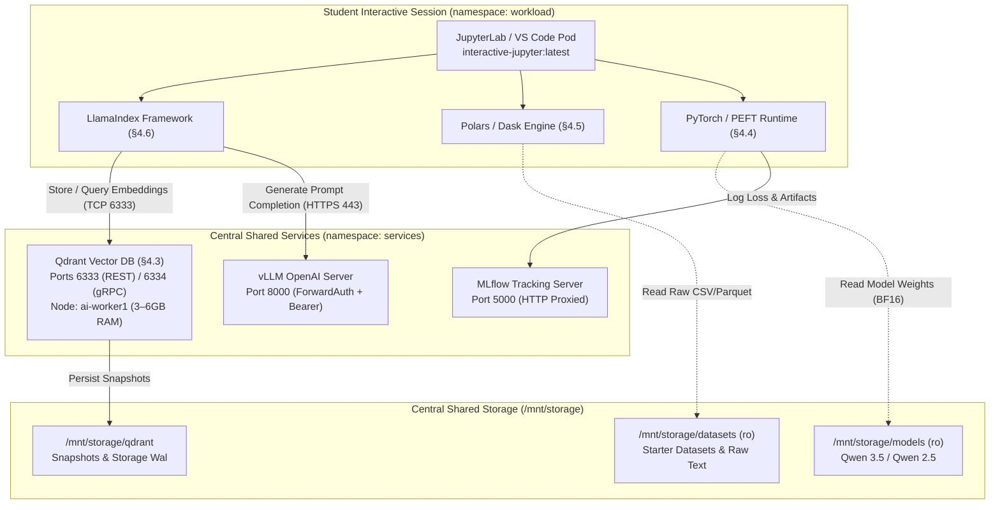

# WP3-1-14: Central Vector DB (Qdrant) & Starter Lab Curricula Specification

**Status:** 🟡 Staged for Implementation (Phase 3)  
**Target Tier:** Tier 2 Central Shared Services (`services` namespace) & Client Runtime Images  
**Relevant Tech Stack Decisions:** [TECH_STACK_DECISION.md](./TECH_STACK_DECISION.md) §§4.3, 4.4, 4.5, 4.6  
**Authors:** Khem & Antigravity (Senior Systems Architect & Co-Architect)  

---

## 1. Executive Summary & Purpose

While Milestone 3 stabilized the core inference (`vLLM`) and experiment telemetry (`MLflow`) services, the AI Sandbox is incomplete without:
1. **Central Vector Database (Qdrant - §4.3):** The final remaining always-on microservice required for university Retrieval-Augmented Generation (RAG) coursework.
2. **Client Runtime & SDK Alignment (§§4.4–4.6):** Pre-baking required client-side libraries (`polars`, `dask`, `llama-index`, and GPU PEFT fine-tuning dependencies) into container images so students encounter zero setup friction.
3. **Turnkey Starter Lab Notebooks:** Copy-paste, battle-tested notebooks pre-loaded into every student's workspace demonstrating the full physical data path (Slurm batch, Polars ETL, MLflow logging, LlamaIndex + Qdrant RAG, and GPU LoRA fine-tuning).

---

## 2. Tier 1 — Mental Model: End-to-End Data Path

The diagram below illustrates how student interactive notebooks in `workload` interact with both Tier 2 central shared services and cluster storage:

---

## 3. Tier 2 — Architectural Decisions & Specifications

### 3.1 Central Vector Database: Qdrant (§4.3)

*   **Deployment Topology:** Single-replica Kubernetes `StatefulSet` deployed in the `services` namespace, scheduled on CPU worker node `ai-worker1` (avoiding GPU node memory contention).
*   **Memory & Indexing Architecture:**
    *   Vectors and HNSW graph structures are held **in-memory** (3–6 GB RAM allocation) for sub-5ms search latencies across student RAG queries.
    *   We reject running Qdrant over pure NFS mmap files due to NFS lock and IOPS penalties.
    *   Persistent storage (`qdrant-data-pvc`, 20Gi) mounted to `/qdrant/storage` is used strictly for Write-Ahead Logs (WAL) and periodic snapshot flushes.
*   **Networking & Gateway Ingress:**
    *   **Internal Service DNS:** `http://qdrant.services.svc.cluster.local:6333` (REST API) and port 6334 (gRPC).
    *   **External Gateway Routing:** Traefik reverse proxy path `PathPrefix('/qdrant')` for administrative web UI and remote dashboard exploration.
    *   **CNI NetworkPolicy:** `k8s/network-policies/allow-qdrant-egress.yaml` in `workload` namespace allowing student pods to connect to `services` pods with label `app.kubernetes.io/name: qdrant` on TCP ports 6333 and 6334.

### 3.2 Client Runtime & Pre-Baked Images (§§4.4–4.6)

To adhere to our core architectural principle (**zero runtime pip installs or dynamic container build dependencies on shared NFS**), the following libraries must be pre-baked:

1.  **Data Processing (§4.5):**
    *   Install `polars[all]` and `dask[complete]` in `images/jupyterlab/Dockerfile`.
    *   Allows out-of-core chunked processing of CSV, Parquet, and JSON datasets without saturating container RAM.
2.  **RAG Orchestration (§4.6):**
    *   Install `llama-index-core`, `llama-index-llms-openai-like`, `llama-index-embeddings-huggingface`, and `llama-index-vector-stores-qdrant` in `images/jupyterlab/Dockerfile`.
    *   Configured by default to route completions to `https://portal.slurm.svc.cluster.local/v1` and vectors to `http://qdrant.services.svc.cluster.local:6333`.
3.  **ML Training & Fine-Tuning (§4.4):**
    *   Build a dedicated GPU image (`images/training-gpu/Dockerfile`) or Apptainer definition based on `nvcr.io/nvidia/pytorch` pre-bundling `peft`, `transformers`, `accelerate`, `bitsandbytes`, and `flash-attn`.
    *   *Note on Pre-puller:* Reconcile §4.4 text in [TECH_STACK_DECISION.md](./TECH_STACK_DECISION.md) to formally reflect that local containerd layer caching and the in-cluster registry (`localhost:5000`) replace the DaemonSet pre-puller.

---

## 4. Starter Lab Curriculum Suite

Pre-populated in every student's home workspace under `/mnt/storage/projects/<project>/starter_labs/`:

| Notebook | Focus | Stack Used | Data Path & External Endpoints |
| :--- | :--- | :--- | :--- |
| `01_hello_sandbox.ipynb` | Cluster Orientation & Job Submission | Python, Slurm REST/CLI | Query node state via Slurm API; launch sample `sbatch` batch job. |
| `02_data_processing_polars.ipynb` | Single-Node Out-of-Core ETL (§4.5) | Polars, Dask | Stream & transform 5GB dataset from `/mnt/storage/datasets`; write Parquet to scratch. |
| `03_experiment_tracking_mlflow.ipynb` | Experiment Tracking (§4.10) | MLflow, PyTorch | Train toy model; log parameters, metrics, and artifact plots to central MLflow (`port 5000`). |
| `04_llm_inference_and_rag.ipynb` | Production RAG Pipeline (§4.3, §4.6) | LlamaIndex, Qdrant, vLLM | Ingest syllabus text $\rightarrow$ index into Qdrant (`port 6333`) $\rightarrow$ retrieve context $\rightarrow$ generate via vLLM with Bearer auth. |
| `05_gpu_lora_finetuning.ipynb` | Parameter-Efficient Fine-Tuning (§4.4) | PyTorch, PEFT, bitsandbytes | Load BF16 weights from `/mnt/storage/models` $\rightarrow$ run QLoRA on L40 $\rightarrow$ stream checkpoints to MLflow. |

---

## 5. Implementation Roadmap & Checklist

- [ ] **Phase A: Qdrant Infrastructure Deployment**
  - [ ] Create `k8s/qdrant/01-storage.yaml` (PV and PVC `qdrant-data-pvc`).
  - [ ] Create `k8s/qdrant/02-statefulset.yaml` (pinned to `ai-worker1`, 4GB RAM limits, ports 6333/6334).
  - [ ] Create `k8s/network-policies/allow-qdrant-egress.yaml`.
  - [ ] Update Traefik dynamic config in `k8s/traefik-security-configmap.yaml` for `/qdrant`.
  - [ ] Build automated verification script `scripts/verify-qdrant.sh`.
- [ ] **Phase B: Client Image Updates**
  - [ ] Update `images/jupyterlab/Dockerfile` with `polars`, `dask`, and `llama-index` packages.
  - [ ] Rebuild and push `interactive-jupyter:latest` to local registry (`localhost:5000`).
  - [ ] Reconcile `docs/TECH_STACK_DECISION.md` §4.4 (containerd caching vs DaemonSet pre-puller).
- [ ] **Phase C: Curriculum Notebooks Authoring & Verification**
  - [ ] Author the 5 starter notebooks in `templates/starter_labs/`.
  - [ ] Validate headless execution via automated test runner (`pytest` / `papermill`).
